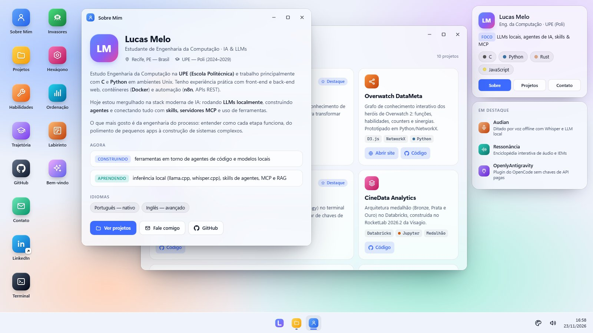
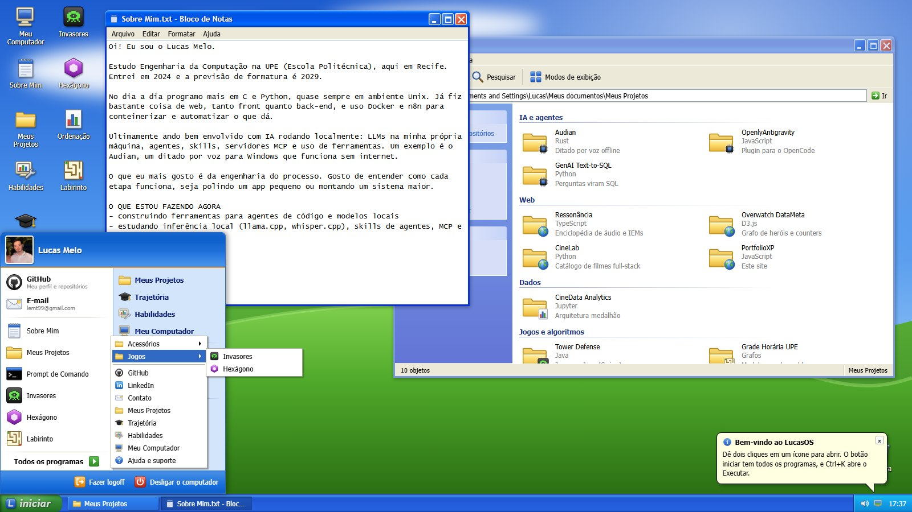
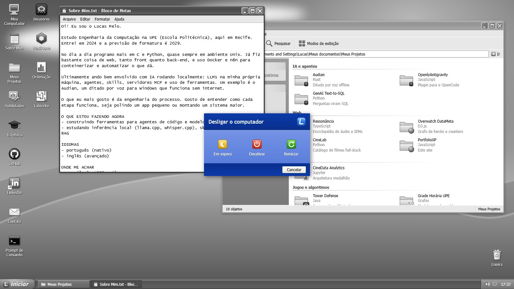
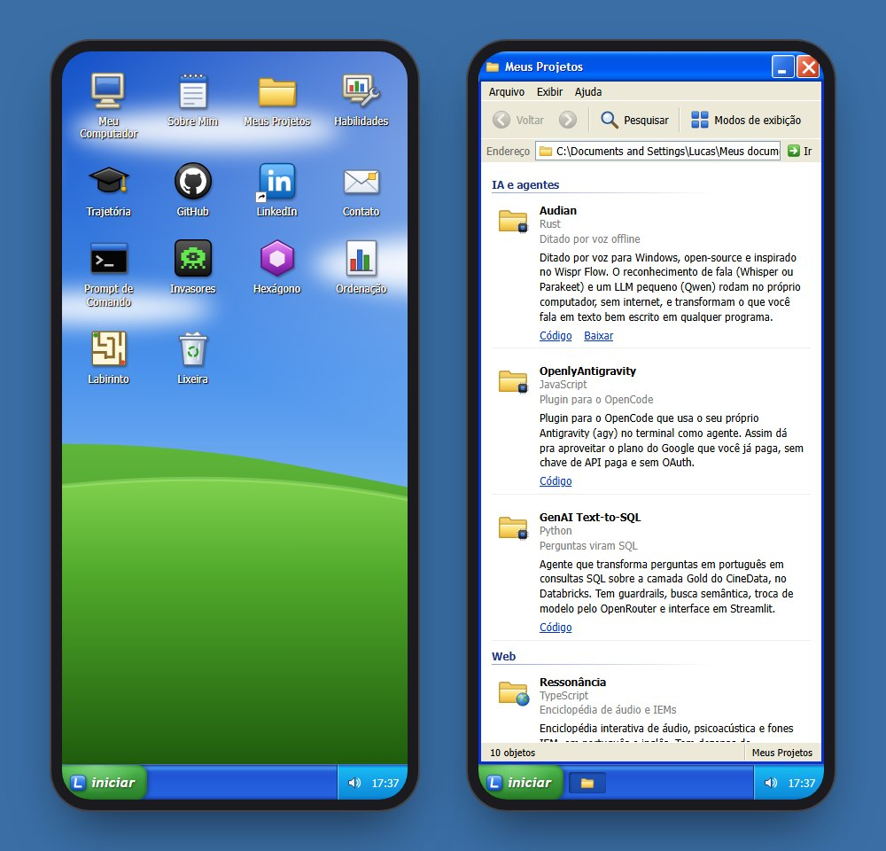

# PortfolioXP

**Meu portfólio pessoal em forma de Windows XP. Bem-vindo ao _LucasOS_.**

[](https://lucasstml.github.io/PortfolioXP/)




---

## Sobre

Em vez de um currículo comum, este portfólio é uma área de trabalho do Windows XP. Você liga o computador, vê a tela de boot, o "bem-vindo", e cai numa área de trabalho com ícones, janelas, barra de tarefas e menu iniciar.

Cada parte do portfólio abre como um programa do XP: o "Sobre Mim" é um arquivo no Bloco de Notas, os projetos ficam numa pasta do Explorer, as habilidades numa janela de propriedades com abas, e o contato é uma "Nova mensagem". Junto disso tem um Prompt de Comando, dois jogos e dois visualizadores de algoritmos.

Tudo foi feito com **HTML, CSS e JavaScript puros**, sem biblioteca, framework ou etapa de build.

## O que tem na área de trabalho

| Ícone | Programa | O que é |
|:---:|---|---|
| 🖥️ | **Meu Computador** | "Propriedades do sistema" com um resumo sobre mim |
| 📝 | **Sobre Mim** | Quem eu sou e o que estou fazendo agora, no Bloco de Notas |
| 📁 | **Meus Projetos** | Pasta do Explorer com um ícone para cada projeto, separados por área, com descrição e links no painel de detalhes |
| 🛠️ | **Habilidades** | Janela de propriedades com abas: linguagens, IA, web e dados, ferramentas e pessoal |
| 🎓 | **Trajetória** | UPE, RocketLab 2026.2 (Visagio) e formação, em modo de exibição "Detalhes" |
| 🐙 | **GitHub** | Navegador com meu perfil e meus repositórios, carregados ao vivo pela API do GitHub |
| in | **LinkedIn** | Atalho para o meu perfil |
| 🌐 | **Site moderno** | Atalho para a versão tradicional do portfólio |
| 📄 | **Currículo.htm** | Atalho para o meu currículo em HTML de 1996 |
| ✉️ | **Contato** | "Nova mensagem" que abre seu programa de e-mail, mais telefone e links |
| `>_` | **Prompt de Comando** | Terminal com comandos, histórico e autocompletar |
| 👾 | **Invasores** | Jogo de nave com três fases, power-ups e recorde |
| ⬡ | **Hexágono** | Jogo de reflexo: desvie das paredes que se fecham |
| 📊 | **Ordenação** | Seis algoritmos de ordenação animados |
| 🧩 | **Labirinto** | Gerador de labirintos com busca por BFS, DFS, Dijkstra e A\* |
| 🗑️ | **Lixeira** | Versões antigas deste site |

## Coisas do XP que dá para encontrar

- **Boot, "bem-vindo" e logon:** a tela preta com a barra de progresso, a tela azul de boas-vindas e, ao fazer logoff, a tela de logon com a minha foto.
- **Fazer logoff e Desligar:** a tela vai ficando cinza enquanto o diálogo está aberto, igual ao XP. Dá para entrar em espera, desligar ou reiniciar.
- **Animação de minimizar:** a barra de título "voa" até o botão na barra de tarefas (e volta ao restaurar ou maximizar).
- **Menu iniciar** com a foto do usuário, programas fixados, "Todos os programas" com submenus (Acessórios e Jogos) e os botões de logoff e desligar.
- **Balões** na área de notificação, **dicas amarelas** ao passar o mouse, **cursor de "carregando"** ao abrir programas e **retângulo de seleção** ao arrastar na área de trabalho.
- **Propriedades de Vídeo** (botão direito na área de trabalho > Propriedades): esquemas de cores **Azul**, **Verde-oliva** e **Prateado**, papel de parede, efeitos e tema **Vista**.
- **Proteção de tela:** depois de alguns minutos parado, aparece o logo flutuante ou o campo de estrelas.
- **Executar** (`Ctrl` + `K` ou `/`): digite o nome de um programa, de um projeto ou um endereço da internet.
- **Sons** sintetizados com a Web Audio API, sem nenhum arquivo de áudio.

<p align="center">
  
  
</p>

## No celular

No celular os ícones viram uma tela inicial, as janelas abrem em tela cheia, o botão voltar do aparelho fecha o programa e os jogos ganham botões na tela.

<p align="center"></p>

## Prompt de Comando

| Comando | O que faz |
|---|---|
| `help` | Lista os comandos |
| `sobre`, `projetos`, `contato` | Informações sobre mim, com links |
| `neofetch` | Ficha técnica do *LucasOS* |
| `dir` | Lista os programas |
| `start <programa>` | Abre um programa (ex.: `start labirinto`) |
| `color 0a` | Muda as cores do terminal, como no Windows |
| `title <texto>` | Muda o título da janela |
| `tema azul\|oliva\|prateado\|vista` | Troca a aparência |
| `ver`, `date`, `time`, `echo`, `whoami` | O de sempre |
| `logoff`, `shutdown`, `cls`, `exit` | Também funcionam |

Tem ainda um comando secreto que não aparece no `help`.

## Links diretos

- `#projetos`, `#terminal`, `#github`, `#contato`... abrem o programa direto.
- `?tema=oliva`, `?tema=prateado` ou `?tema=vista` abrem o site com aquela aparência.

## Estrutura

```
index.html            página e conteúdo das janelas (textos, projetos, trajetória)
assets/css/style.css  esquemas de cores, janelas, menus, Explorer e as telas de boot/logon
assets/js/os.js       janelas, barra de tarefas, menu iniciar, logoff/desligar, proteção de tela
assets/js/apps.js     Bloco de Notas, Explorer, navegador, Executar, terminal, jogos e algoritmos
assets/img/           favicon e o papel de parede "Colinas" (SVG)
```

Para mudar alguma coisa:

| Onde | Para quê |
|---|---|
| `index.html` | Textos. Para adicionar um projeto, copie um `<article class="ex-item">` em "Meus Projetos" |
| `os.js` → `CONFIG` e `APPS` | Links, e-mail, ícones da área de trabalho e dicas de cada programa |
| `apps.js` → `GAME_CONFIG` | Velocidades, vidas, fases e power-ups dos jogos; tamanho do labirinto |
| `style.css` → `[data-scheme="..."]` | Cores de cada esquema |

Para rodar localmente, sirva a pasta com qualquer servidor estático (por exemplo `python -m http.server`) e abra `http://localhost:8000`.

## Outras versões

O mesmo conteúdo também está num site tradicional, no repositório [`lucas-melo`](https://github.com/LucassTml/lucas-melo):

- **[Versão moderna](https://lucasstml.github.io/lucas-melo/):** preta, minimalista e com animações, incluindo os visualizadores de algoritmos.
- **[Currículo, edição 1996](https://lucasstml.github.io/lucas-melo/curriculo/):** meu currículo como uma home page dos anos 90, em HTML 3.2 sem CSS nem JavaScript.

Os dois também aparecem como ícones na área de trabalho e no menu Iniciar.

## Versões anteriores

- **v1:** a primeira versão do site, no branch [`v1`](https://github.com/LucassTml/PortfolioXP/tree/v1).
- **2.0 moderno:** uma versão com visual moderno que ficou pouco tempo no ar, no commit [`b76f039`](https://github.com/LucassTml/PortfolioXP/tree/b76f039).

As duas também estão na Lixeira do site.

## Contato

**Lucas Melo**, estudante de Engenharia da Computação na Universidade de Pernambuco (UPE, Escola Politécnica), em Recife.

[](https://www.linkedin.com/in/lucas-eduardo-melo-tenorio-05326a311/)
[](https://github.com/LucassTml)

---

<sub>Projeto pessoal sem fins comerciais. Windows XP e Windows Vista são marcas registradas da Microsoft Corporation, e este projeto não tem qualquer afiliação com a empresa.</sub>
