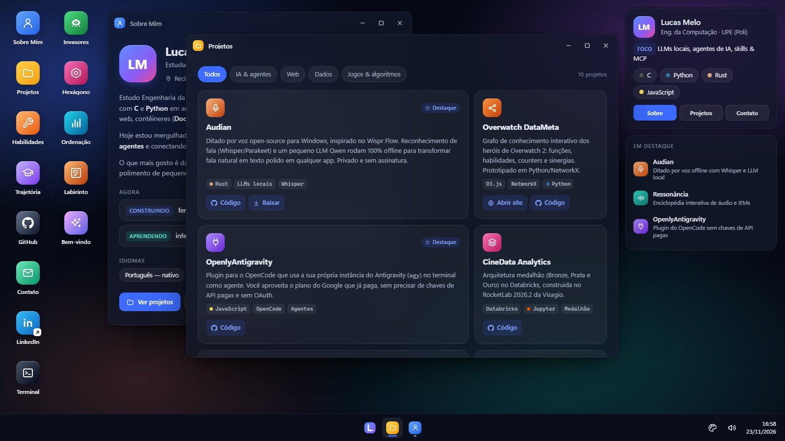
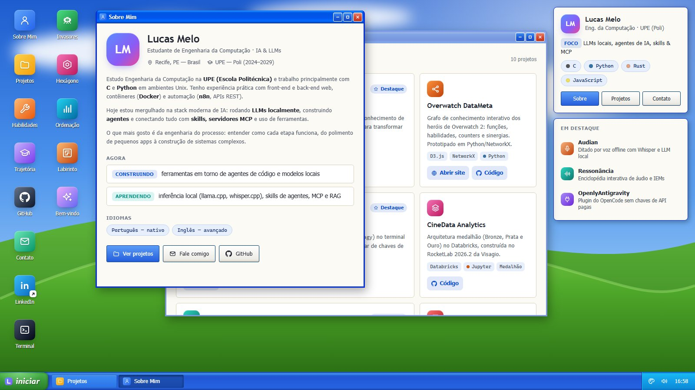

# PortfolioXP · LucasOS 2.0

**Meu portfólio pessoal em forma de sistema operacional no navegador. Começou inspirado no Windows XP e agora tem visual moderno, modo escuro e versão para celular. O XP e o Vista continuam a um clique de distância.**

[](https://lucasstml.github.io/PortfolioXP/)


---

## Sobre

Em vez de uma página de currículo comum, este portfólio é uma **área de trabalho interativa**: ícones, janelas, barra de tarefas, menu Iniciar com busca, terminal, mini-jogos e visualizadores de algoritmos. Cada seção (Sobre Mim, Projetos, Habilidades, Trajetória e Contato) abre como uma janela.

Tudo é feito com **HTML, CSS e JavaScript puros**, sem bibliotecas, frameworks ou etapa de build.

## Novidades da versão 2

- **Visual moderno** com vidro fosco, modo claro/escuro automático e 6 cores de destaque. Os temas **XP (Luna)** e **Vista (Aero)** continuam disponíveis.
- **Versão para celular**: tela inicial com os apps, janelas em tela cheia, botão "voltar" do aparelho fechando o app e controles de toque nos jogos.
- **Conteúdo atualizado** a partir do meu perfil do GitHub: foco atual em IA (LLMs locais, agentes, skills e MCP), novos projetos (Audian, OpenlyAntigravity, Ressonância, GenAI Text-to-SQL, CineData, CineLab, Grade Horária) e novos apps **Trajetória** e **GitHub** (repositórios ao vivo).
- **Busca no menu Iniciar** (`Ctrl` + `K` ou `/`) por apps, projetos e comandos ("tema xp", "modo escuro", "copiar e-mail"…).
- **Janelas melhores**: arrastam com mouse, caneta ou toque; encaixam nas bordas (topo maximiza, laterais dividem a tela); redimensionam pela lateral, pela base ou pelo canto; duplo clique na barra de título maximiza.
- **Links diretos**: `#projetos`, `#terminal`, `#github`… abrem o app, e `?tema=xp`, `?tema=vista` ou `?modo=escuro` abrem no visual escolhido.
- **Mais rápido**: nenhuma imagem externa no carregamento (papéis de parede em CSS/SVG), apps iniciam só quando abertos, jogos pausam quando a janela some e rodam na mesma velocidade em telas de 60, 120 ou 144 Hz, com canvas nítido em telas de alta densidade.
- **Acessibilidade e SEO**: botões de verdade com rótulos, navegação por teclado, respeito a `prefers-reduced-motion`, metadados Open Graph, dados estruturados e conteúdo legível mesmo sem JavaScript.

> A primeira versão continua guardada no branch [`v1`](https://github.com/LucassTml/PortfolioXP/tree/v1).

<p align="center">
  
  
</p>
<p align="center"></p>

## O que tem na área de trabalho

| Ícone | Aplicativo | O que faz |
|:---:|---|---|
| 🧑‍💻 | **Sobre Mim** | Quem eu sou, o que estou construindo e aprendendo agora, idiomas |
| 📁 | **Projetos** | Projetos com filtros (IA, Web, Dados, Jogos & algoritmos) e links para código e demos |
| 🛠️ | **Habilidades** | Stack por área: linguagens, IA & LLMs, web, dados, DevOps e interpessoais |
| 🎓 | **Trajetória** | Engenharia da Computação na UPE, RocketLab 2026.2 (Visagio) e formação |
| 🐙 | **GitHub** | Perfil e repositórios carregados ao vivo pela API do GitHub (com lista reserva offline) |
| ✉️ | **Contato** | E-mail com botão de copiar, LinkedIn, GitHub, telefone e um formulário que abre seu app de e-mail |
| in | **LinkedIn** | Atalho para o meu perfil |
| `>_` | **Terminal** | Prompt com comandos, histórico e autocompletar |
| 👾 | **Invasores** | Tiro de nave com três fases, power-ups e recorde salvo |
| ⬡ | **Hexágono** | Jogo de reflexo: desvie das paredes que se fecham, com recorde salvo |
| 📊 | **Ordenação** | Seis algoritmos de ordenação animados, com contadores e controle de velocidade |
| 🧩 | **Labirinto** | Gerador de labirintos e busca de caminhos com BFS, DFS, Dijkstra e A\* |
| ✨ | **Bem-vindo** | Dicas de uso e novidades da versão 2 |

## Funcionalidades

### 🪟 Experiência de sistema operacional
- **Tela de boot** do *LucasOS* (só na primeira visita da sessão), que abre Sobre Mim e Projetos ao iniciar.
- **Barra de tarefas** com as janelas abertas, relógio, sons e o painel **Personalizar**.
- **Personalizar**: tema (Moderno, XP, Vista), aparência clara/escura/automática, cor de destaque e papel de parede (Aurora, Noite, Colinas, Aero ou uma imagem do seu computador). As escolhas ficam salvas no navegador.
- **Menu de contexto**: clique com o botão direito na área de trabalho.
- **Efeitos sonoros** sintetizados em tempo real com a Web Audio API, sem nenhum arquivo de áudio.
- **Encerrar sessão** de verdade: desliga o LucasOS e religa com um clique.

### 🎮 Mini-jogos
- **Invasores:** três fases com dificuldade crescente; os invasores aceleram conforme a tropa diminui. Ao concluir uma fase, escolha 1 entre 3 power-ups (*+1 Vida*, *Tiro Duplo*, *Tiro Rápido*, *Nave Ágil* ou *Escudo*), pelo mouse ou pelas teclas `1` `2` `3`.
  Controles: `←` `→` ou `A` `D` para mover e `Espaço` para atirar (segure para atirar sem parar). No celular, botões na tela.
- **Hexágono:** desvie das paredes que se fecham em direção ao centro, com velocidade que aumenta a cada segundo.
  Controles: `←` `→` ou `A` `D` para girar e `Espaço` para começar. No celular, toque nas metades da tela ou use os botões.

### 📊 Visualizadores de algoritmos
- **Ordenação:** **Bubble**, **Selection**, **Insertion**, **Quick**, **Merge** e **Heap Sort**, com quantidade de barras e velocidade ajustáveis, contadores de comparações e trocas e a complexidade de cada um.
- **Labirinto:** gera labirintos aleatórios com *backtracking* (com alguns atalhos extras, para que os algoritmos encontrem caminhos diferentes) e resolve com **BFS**, **DFS**, **Dijkstra** ou **A\***. Mostra células visitadas, tamanho do caminho e o tempo real de execução do algoritmo.

### `>_` Terminal
Um prompt no estilo `lucas@lucasos:~$` (ou `C:\Users\Lucas>` nos temas clássicos), com histórico (`↑` `↓`) e autocompletar (`Tab`):

| Comando | Resultado |
|---|---|
| `help` / `ajuda` | Lista os comandos |
| `sobre` / `whoami` | Resumo sobre mim / usuário atual |
| `neofetch` | Ficha técnica do *LucasOS* |
| `projetos` / `skills` / `contato` | Projetos com links, stack e formas de contato |
| `ls` / `dir` | Lista os apps instalados |
| `open <app>` | Abre um app (ex.: `open labirinto`) |
| `tema <moderno\|xp\|vista\|claro\|escuro>` | Troca o visual |
| `github`, `date`, `echo`, `history` | O que o nome diz |
| `clear` / `cls`, `exit` | Limpa a tela / fecha o terminal |

## Estrutura e personalização

```
index.html            estrutura da página e conteúdo das janelas (textos, projetos, trajetória)
assets/css/style.css  temas, papéis de parede, layout e componentes
assets/js/os.js       núcleo: janelas, barra de tarefas, menu Iniciar, busca, personalização
assets/js/apps.js     terminal, GitHub ao vivo, jogos e visualizadores
assets/img/           favicon e papel de parede "Colinas" (SVG)
```

| Onde | Para que serve |
|---|---|
| `os.js` → `CONFIG` | Usuário do GitHub, links do GitHub e do LinkedIn, e-mail |
| `os.js` → `APPS` | Lista e ordem dos apps (título, ícone, cor e palavras-chave da busca) |
| `apps.js` → `GAME_CONFIG` | Velocidades, vidas, fases e power-ups dos jogos; tamanho do labirinto |
| `style.css` → `:root`, `[data-theme="xp"]`, `[data-theme="vista"]` | Cores e medidas de cada tema |
| `index.html` | Textos das janelas; para adicionar um projeto, copie um `<article class="project">` |

Para rodar localmente, sirva a pasta com qualquer servidor estático, por exemplo `python -m http.server`, e abra `http://localhost:8000`.

## Tecnologias

- **HTML5 e CSS3:** layout, três temas, papéis de parede em gradientes e SVG, container queries
- **JavaScript puro:** gerenciador de janelas, busca, terminal, jogos e algoritmos
- **Canvas API:** renderização dos mini-jogos
- **Web Audio API:** efeitos sonoros gerados por código
- **API REST do GitHub:** perfil e repositórios ao vivo
- **GitHub Actions e GitHub Pages:** CI/CD e hospedagem

## Contato

**Lucas Melo**, estudante de Engenharia da Computação na Universidade de Pernambuco (UPE – Poli), em Recife.

[](https://www.linkedin.com/in/lucas-eduardo-melo-tenorio-05326a311/)
[](https://github.com/LucassTml)
[](mailto:lemt99@gmail.com)

---

<sub>Projeto pessoal sem fins comerciais. Windows XP e Windows Vista são marcas registradas da Microsoft Corporation, e este projeto não tem qualquer afiliação com a empresa.</sub>
